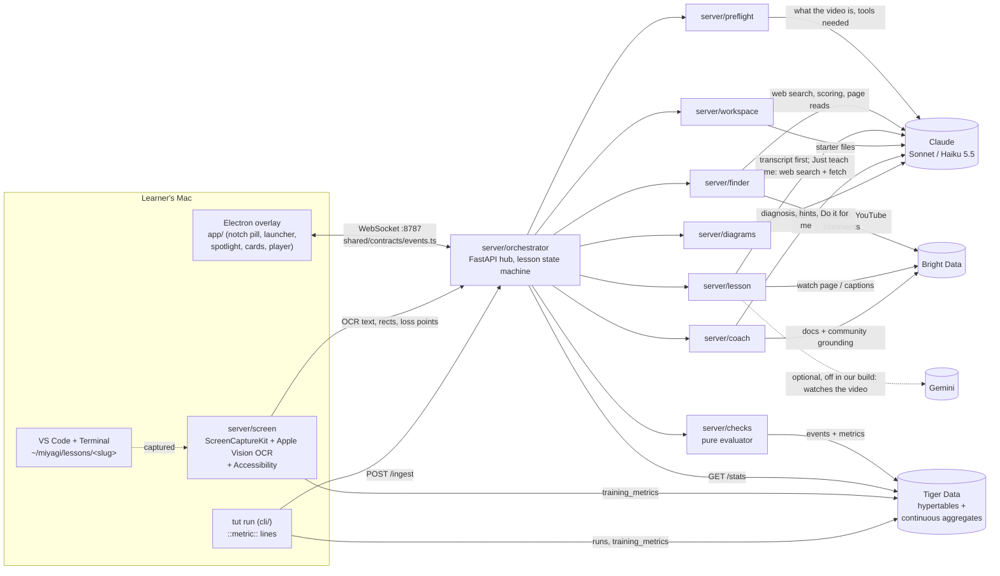

# miyagi

**Turn any tutorial into an auto-graded lab.** Ask Miyagi anything.

Press **⌥Space** and a launcher grows out of the notch island. Type what you want to learn, then pick one of **two ways to
learn**:
- **Watch a video** (↵):
  1. A YouTube-only search: Claude web search plus Bright Data's Google video results, with Bright Data reading each video's
     comments for "doesn't work anymore".
  2. A preflight card: what the video is and what you need for it.
  3. A lesson that Claude builds from the video's transcript. (A Gemini path that watches the video itself exists, but it's off in our build to control cost.)
  4. The video, gated step by step.
- **Just teach me** (⌘↵, Claude only): no video. Claude researches the topic with web search and the official docs, writes the
  lesson, and opens VS Code full screen.

Either way, Miyagi watches **your whole screen**. It dims everything except a white box on the exact code line or the VS Code
terminal, and each step waits until your screen shows it really works: the code is there, the output is right, the loss is
falling. When a check fails, a Claude Sonnet coach reads your actual screen and code and tells you what's wrong: hints first, then
the exact fix, then a "Do it for me" you confirm and can undo. The bottom bar has **Check**, **Skip step** and **End lesson**,
and lessons survive an engine restart.

Built at SanD Hacks 2026 (UCSD, Nov 14–15). Devpost write-up: [`docs/devpost/SUBMISSION.md`](docs/devpost/SUBMISSION.md) ·
demo script: [`docs/devpost/DEMO.md`](docs/devpost/DEMO.md).

## 30-second quickstart (macOS)

Put your keys in `.env` at the repo root (copy `.env.example`; `ANTHROPIC_API_KEY` is the only model key you need; `GEMINI_API_KEY` is optional and unused with `LESSON_ENGINE=claude`), or enter them
in the app's Settings sheet. Never commit `.env`.

```bash
scripts/miyagi-engine.sh
```
That starts the engine on `ws://localhost:8787`. On first run it creates `.venv` with Python 3.12 via `uv`. It prints where to grant
**Screen Recording** if the terminal doesn't have it yet.

```bash
cd app && npm install && npm run dev
```
That starts the overlay (Electron). Use the app from branch `adrian/shell`, which is ahead of `integration/live`'s copy. Then press
**⌥Space** and type `learn physics informed machine learning with PINNs in PyTorch`.

Other ways to run it:
- `scripts/miyagi-demo.sh`: the stage hero (Toscano's PINN video `AXXnSzmpyoI`, cached lesson, `demo/pinn-lab`), autostarted,
  everything else live.
- `DEMO=1 scripts/miyagi-engine.sh`: cached search, lesson and coach cards, with no live API calls (checks stay real).
- `cd app && DEMO=1 npm run dev`: the scripted lesson inside Electron, with no engine and no network.
- `python -m server.orchestrator.client --autopilot`: a fake learner that drives the real state machine.

## Architecture



| Folder | What it does |
|---|---|
| `app/` | Electron + React + TypeScript overlay: the notch pill, the ⌥Space launcher, the spotlight (dims the screen around a rect), cards, diagrams, the YouTube player that pauses at each step's end. Speaks only `shared/contracts/events.ts`. |
| `server/orchestrator/` | The hub (FastAPI on :8787): lesson state machine, don't-nag gate, hint ladder, Do it for me (preview → confirm → apply → undo), `DEMO=1` replay. |
| `server/finder/` | Real tutorial search: YouTube videos only by default (`FINDER_KINDS=all` adds blogs, notebooks, repos and papers), scored by Claude, with a relevance floor. |
| `server/preflight/` | A card within 5 s of the pick (style, length, goal fit, tools needed) with Build / Pick another; nothing is built before you say so. |
| `server/lesson/` | Watch a video: transcript (Claude; an optional Gemini path watches the video itself, off in our build) → step graph; Just teach me: `textlesson.py`, Claude only. Video → step graph (long videos part by part, `progressive.py`) with screen-gradable checks (`step-graph.schema.json`), cached in `demo/cache/lessons/`. |
| `server/workspace/` | One folder per lesson with Claude-written starter files that never pass a step on their own; opens VS Code. |
| `server/screen/` | Whole-screen reader: ScreenCaptureKit → `screencapture` (the macOS 26 fallback) → CoreGraphics; Apple Vision OCR on the device; terminal/editor regions → spotlight rect; loss read off the terminal. |
| `server/sessions/` | Restart-safe lesson saves and the resume card. |
| `server/checks/` | Pure check evaluator (`screen_contains`, `metric_threshold`, `metric_trend` with Mann-Kendall + Theil-Sen), Tiger writers with an offline spool. |
| `server/coach/` | Claude Sonnet diagnosis from the real screen (set-of-mark images + cursor), hint ladder, whitelisted citations, Bright Data docs grounding. |
| `server/diagrams/` | ⌥D: a Claude-built diagram for the current step (network, flow, git graph, data, sequence). |
| `cli/` | `tut run <cmd>`: precision mode for training scripts (`::metric::` lines → engine + Tiger), `tut db`, `tut stats`. |
| `shared/contracts/` | The boundary: WebSocket events, step-graph and check schemas, metric protocol, Tiger schema. |
| `evals/lesson/` | Lesson builder on 5 non-PINN tutorials (`report.md`). |

**Model rule:** Claude reads screens, code and transcripts. We run `LESSON_ENGINE=claude`, so Gemini is off. Cost controls: Sonnet and Haiku only
(Opus needs an explicit opt-in, `LESSON_ALLOW_OPUS=1`), Gemini off, and per-model token counts in every lesson's `build.cost`. No fake data on the live path: a module that
fails sends an `error` event with the reason, and canned data exists only behind `DEMO=1`.

## How each sponsor's tech is used

| Sponsor | Used for | Where |
|---|---|---|
| **Bright Data** (live) | SERP API for Google's video results; YouTube comments dataset (flags "doesn't work anymore" tutorials); Web Unlocker as the route for captions/watch pages and the coach's docs | `server/finder/brightdata.py`, `sources.py`; `server/lesson/transcript.py`; `server/coach/web.py` |
| **Tiger Data** | `learning_events` + `training_metrics` hypertables; continuous aggregates `metrics_1s`, `time_per_step`, `check_fail_rate`, `stuck_heatmap`, `learner_progress`; live page at `localhost:8787/stats` | `shared/contracts/tiger-schema.sql`, `cli/sql/tiger-extras.sql`, `server/checks/tiger.py`, `server/checks/stats_web.py` |
| **Gemini** | Optional video-watching path (`LESSON_ENGINE=claude-first` or `auto`): watches the YouTube video (`file_data`, structured JSON) when there's no transcript; daily cap. Off in our build to control cost; the cached hero lesson was built with it | `server/lesson/gemini.py`, `server/lesson/progressive.py` |
| **GoDaddy** | Domain `miyagi.study` (the app's YouTube Referer; registration to confirm) | `app/src/main/index.ts` |
| ElevenLabs · xAI · Vultr | **Pending Michael's decision.** ElevenLabs voice code exists (`server/coach/voice.py`) but hasn't been verified live; nothing uses xAI or Vultr | – |
| **Claude** (Anthropic) | Search + scoring, transcript lesson path, scaffolding, the coach, diagrams, screen pointing | `server/finder/claude.py`, `server/lesson/claude.py`, `server/workspace/`, `server/coach/`, `server/diagrams/` |

Details and measured numbers: [`docs/devpost/SUBMISSION.md`](docs/devpost/SUBMISSION.md).

## Tests

```bash
.venv/bin/python -m pytest server/orchestrator -q      # each module's README has its own test command
```
The tests run offline: Gemini and Claude are faked or replayed from recorded fixtures, and the finder tests replay recorded real
responses. The `server/screen` fixture tests run real Vision OCR and are macOS only.

## More docs

- `docs/PLAN.md`: the original build plan · `docs/WORKFLOW.md`: branches, worktrees, many Claude sessions
- `docs/FRONTEND-HANDOFF.md`: the overlay spec · `docs/research/screen-understanding.md`: cursor, OCR and Accessibility research
- `app/brand/BRAND.md`: name, voice, logo, color · `docs/PIPELINE.md`: search → preflight → build → setup → run

## Team

- **Michael Tarekegn**: engine (`server/`, `cli/`, contracts), with many parallel Claude Code sessions
- **Adrian Erlikhman**: Electron overlay (`app/`), brand
