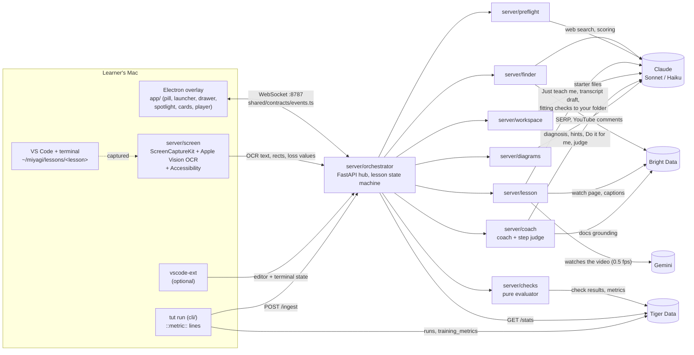

# Miyagi

**Learn anything by doing.** Miyagi is a macOS overlay that lives under your MacBook's notch. Tell it what you want to learn
("build a neural network in PyTorch") and it finds a good YouTube tutorial or writes a lesson from the web, sets up a project
folder in VS Code, and walks you through it one step at a time. It watches your screen while you work, puts a box around the
exact line to type, checks each step against what's really on your screen (the code is there, the output is right, the loss is
falling), and coaches you when you're stuck. It doesn't move on until your own code works.

Built at **SanD Hacks 2026** (UCSD, Nov 14–15) by Michael Tarekegn and Adrian Erlikhman.
Devpost write-up: [`docs/devpost/SUBMISSION.md`](docs/devpost/SUBMISSION.md) · demo script: [`docs/devpost/DEMO.md`](docs/devpost/DEMO.md)

## How it works in 30 seconds

1. **Pill.** A small pill sits under the notch. Its ring is your lesson progress and its dot is your state: gray while Miyagi
   watches, amber when you're off track, green when a step passes.
2. **Launcher.** Press **⌥Space** and a launcher grows out of the pill. Type what you want to learn and pick how:
   - **Watch a video** (↵). Miyagi searches YouTube, shows a short preflight card (what the video covers, what you need), and
     turns the video into a step-by-step lesson. The video plays one step at a time and pauses until you've done that step.
   - **Just teach me** (⌘↵). No video. Claude researches the topic with web search and the official docs and writes the lesson:
     a plan, what each step builds and why, and the code to type.
3. **Drawer.** A tab on the right edge opens the lesson drawer: every step (done, current, locked), the current step's live
   checks, and the lesson's sources.
4. **Spotlight.** Miyagi dims the screen except for a white box on the exact line of code to type, or on VS Code's terminal
   when it's time to run something.
5. **Checks and coach.** A step passes only when your screen shows it works. Press **Check** any time. When something is wrong,
   the coach reads your screen and code and says what: a hint first, then the exact fix, then **Do it for me**, which you
   confirm and can undo. The bottom bar also has Ask Miyagi, Back, Explain, Diagram, Show me, Hint, Voice, Skip step and End
   lesson.

Lessons survive an engine restart. The VS Code companion extension is optional; without it, Miyagi works from the screen alone.

### What each service does

| Service | Its job in Miyagi |
|---|---|
| **Claude** (Anthropic: Sonnet and Haiku) | Writes the lessons ("Just teach me", the transcript draft of a video lesson, fitting each check to your folder), searches for and scores tutorials, reads your screen to place the spotlight, judges whether a step is done, coaches, explains, draws diagrams |
| **Gemini** | Watches the videos, and nothing else. It watches the YouTube video at 0.5 fps (with its title, description and chapters) and drafts the steps with timestamps, the code typed on screen, checks and hints. Claude's transcript draft runs in parallel and is used if Gemini fails or takes over 75 s |
| **Bright Data** | Finds the videos and sources: SERP API for Google's video results, the YouTube comments dataset (flags tutorials people say "doesn't work anymore"), Web Unlocker for transcripts, watch pages and the coach's docs |
| **Tiger Data** | Stores check results and training metrics: `learning_events` and `training_metrics` hypertables with continuous aggregates (time per step, check fail rate, where learners get stuck). Live page at `localhost:8787/stats` |
| Apple Vision + Accessibility (on the Mac) | Reads the whole screen with on-device OCR and gets exact editor line positions |

## Run it locally (macOS)

You need macOS (the screen reader uses ScreenCaptureKit, Apple Vision and Accessibility), [uv](https://docs.astral.sh/uv/),
Node 22+, VS Code, and an Anthropic API key. Gemini, Bright Data and Tiger Data keys are optional.

```bash
git clone https://github.com/michae6345-crypto/miyagi.git
cd miyagi
cp .env.example .env        # put your keys in .env; never commit it
```

### 1. Engine

```bash
scripts/miyagi-engine.sh
```

This starts the engine on `ws://localhost:8787`. The first run creates `.venv` with Python 3.12 (through `uv`) and installs the
engine and the `tut` CLI. Give the terminal app that runs it **Screen & System Audio Recording** and **Accessibility** in
System Settings › Privacy & Security, then quit and reopen the terminal. The script tells you if the permission is missing.

| Key in `.env` | Needed? | What it turns on |
|---|---|---|
| `ANTHROPIC_API_KEY` | Required | Everything Claude does (see the table above) |
| `GEMINI_API_KEY` | Optional | Gemini watches the videos. Without it, video lessons are built from the transcript by Claude |
| `BRIGHTDATA_API_KEY`, `BRIGHTDATA_SERP_ZONE`, `BRIGHTDATA_UNLOCKER_ZONE` | Optional | Google video results, comment warnings, transcripts and docs through Web Unlocker. Without it, search uses Claude's web search alone |
| `TIGER_DATABASE_URL` | Optional | Stores check results and metrics. Create the tables once with `.venv/bin/tut db init` |

[`.env.example`](.env.example) lists every key the engine reads. You can also enter keys in the app's Settings (⌘,); keys
entered there win over `.env`.

### 2. Overlay app

```bash
cd app && npm ci && npm run dev
```

Then press **⌥Space**, type `build a neural network in PyTorch`, and pick **Just teach me** (⌘↵) or **Watch a video** (↵).
⌃⌥Q quits the overlay.

> The newest overlay (the launcher's two ways to learn, the drawer and the bottom bar) is on the branch
> [`adrian/shell`](https://github.com/michae6345-crypto/miyagi/tree/adrian/shell). Until it's merged here, run the app from a
> checkout of that branch; it talks to this engine over the same contract.

### 3. VS Code companion (optional)

[`vscode-ext/`](vscode-ext/README.md) is a small extension with no build step. It lets the engine read VS Code exactly (the
open file, unsaved edits, the cursor, the terminal's last command and its exit code) and apply a fix for you. It also adds
**Miyagi: Explain this** (Ctrl+Cmd+E on a selection), answered in Miyagi's overlay. It draws nothing in VS Code.

```bash
cp -R vscode-ext ~/.vscode/extensions/miyagi.companion-0.0.3
```

Reload the VS Code window (⌘⇧P → "Developer: Reload Window"), then check it with `curl -s 127.0.0.1:8791/health`.

### Other ways to run it

- `scripts/miyagi-demo.sh`: the stage lesson (Juan Toscano's PINN video `AXXnSzmpyoI`, a cached lesson, `demo/pinn-lab`),
  started automatically, with everything else live.
- `DEMO=1 scripts/miyagi-engine.sh`: cached search, lessons and coach cards, with no live API calls. Checks stay real.
- `scripts/miyagi-offline.sh`: the stage lesson with no network at all.
- `cd app && DEMO=1 npm run dev`: a scripted lesson inside the app, with no engine and no network.

## Tech stack

- **Engine** (`server/`, `cli/`): Python 3.12, FastAPI + uvicorn (one WebSocket hub on :8787), the Anthropic SDK, `google-genai`,
  httpx, psycopg 3, PyObjC (ScreenCaptureKit, Quartz, Apple Vision, Accessibility), watchdog, youtube-transcript-api.
- **Overlay** (`app/`): Electron, React 19, TypeScript, Tailwind CSS 4, Motion, Zustand, electron-vite, the YouTube IFrame API.
- **VS Code companion** (`vscode-ext/`): plain JavaScript, an HTTP API on 127.0.0.1 only (port 8791).
- **Data**: Tiger Data (TimescaleDB hypertables and continuous aggregates).
- **Contract** (`shared/contracts/`): every WebSocket message in `events.ts`, plus JSON Schemas for the step graph and checks.
  The app and the engine speak only this.
- **CI**: GitHub Actions (engine install and import, app typecheck, contract check, macOS app build).

## Architecture



**No fake data on the live path.** A module that fails sends an `error` event with the reason; canned data exists only behind
`DEMO=1`. **Cost controls:** Claude runs on Sonnet and Haiku (Opus needs an explicit opt-in), Gemini has a daily cap
(`LESSON_GEMINI_DAILY_CAP`), and every lesson records its per-model token counts in `build.cost`.

## Repo map

| Folder | What it does |
|---|---|
| `app/` | The Electron overlay: the notch pill, the ⌥Space launcher, the lesson drawer, the spotlight, cards, diagrams, the YouTube player that pauses at each step's end, Settings |
| `server/orchestrator/` | The hub (FastAPI on :8787): lesson state machine, don't-nag gate, hint ladder, Do it for me (preview → confirm → apply → undo), `DEMO=1` replay |
| `server/finder/` | Tutorial search: YouTube videos by default, scored by Claude, with a relevance floor |
| `server/preflight/` | The card shown right after you pick a video (style, length, fit, tools needed); nothing is built until you say so |
| `server/lesson/` | Builds the lesson: Gemini watches the video while Claude drafts from the transcript; long videos part by part; "Just teach me" is `textlesson.py` (Claude only) |
| `server/workspace/` | One folder per lesson with starter files that never pass a step on their own; opens it in VS Code |
| `server/screen/` | The screen reader: capture, on-device Apple Vision OCR, terminal and editor regions for the spotlight, values read off the terminal |
| `server/checks/` | Pure check evaluator (`screen_contains`, `metric_threshold`, `metric_trend`) and the Tiger Data writer with an offline spool |
| `server/coach/` | Claude coach and step judge from your real screen and code, the hint ladder, docs grounding through Bright Data |
| `server/diagrams/` | A Claude-built diagram for the current step (network, flow, git graph, data, sequence) |
| `server/sessions/` | Restart-safe lesson saves and the resume card |
| `cli/` | `tut run <cmd>` (training scripts' `::metric::` lines → engine + Tiger), `tut db init`, `tut stats` |
| `shared/contracts/` | The boundary: WebSocket events, step-graph and check schemas, the Tiger schema |
| `vscode-ext/` | The optional VS Code companion |
| `evals/lesson/` | The lesson builder run on 5 non-PINN tutorials ([`report.md`](evals/lesson/report.md)) |

## Tests

```bash
.venv/bin/python -m pytest server/orchestrator -q     # each module's README has its own test command
cd app && npm run typecheck
cd vscode-ext && npm test
```

The engine tests run offline: Claude and Gemini are faked or replayed from recorded responses. The `server/screen` fixture tests
run real Vision OCR and are macOS only.

## More docs

- [`docs/devpost/SUBMISSION.md`](docs/devpost/SUBMISSION.md): the Devpost write-up, with the file or commit behind each claim
- [`docs/devpost/DEMO.md`](docs/devpost/DEMO.md): the 2-minute demo script and setup
- [`docs/PIPELINE.md`](docs/PIPELINE.md): search → preflight → build → setup → run
- [`app/README.md`](app/README.md): how the overlay works · [`app/brand/BRAND.md`](app/brand/BRAND.md): name, voice, logo, color
- [`docs/WORKFLOW.md`](docs/WORKFLOW.md): branches, worktrees and many parallel Claude Code sessions
- [`docs/research/screen-understanding.md`](docs/research/screen-understanding.md): mouse pointer, OCR and Accessibility research

## Team

- **Michael Tarekegn**: the engine (`server/`, `cli/`, contracts) and the VS Code companion, built with many parallel Claude
  Code sessions
- **Adrian Erlikhman**: the Electron overlay (`app/`) and the brand
