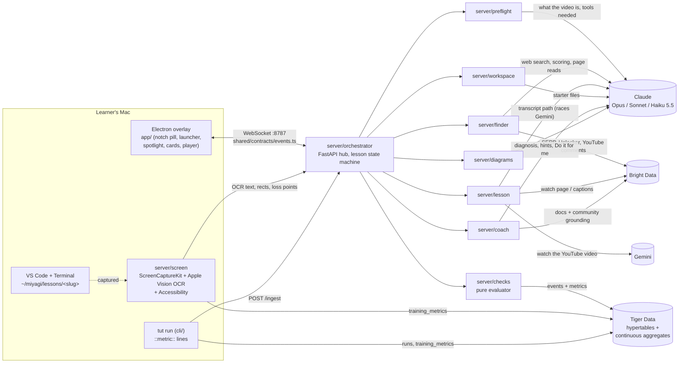

# miyagi

**Turn any tutorial into an auto-graded lab.** Ask Miyagi anything.

Press **⌥Space** and a launcher grows out of the MacBook notch. Type what you want to learn. Miyagi finds a real tutorial on the
live web, turns the video into steps with machine-checkable checks, sets up a project folder and opens VS Code. Then it plays the
video one step at a time. Each step waits until **your own screen** shows the step really works: the code is there, the terminal
output is right, the loss curve is falling. When a check fails, a Claude Opus coach looks at your actual screen and code and tells
you what's wrong, with the card landing 2–4 s after your run ends. It gives hints first, the exact fix if you ask, and a "Do it for me" you have to confirm and can undo.

Two ways to learn:
- **Watch a video:** search, then a preflight card (what the video is and what it needs), then a lesson built from the video, then
  the video gated step by step. Long videos build part by part.
- **Just teach me** (**in progress**, not merged): no video. Claude researches with web search and the official docs and writes
  the lesson itself, and the editor opens full screen with the exact place to type boxed.

Built at SanD Hacks 2026 (UCSD, Nov 14–15). Devpost write-up: [`docs/devpost/SUBMISSION.md`](docs/devpost/SUBMISSION.md) ·
demo script: [`docs/devpost/DEMO.md`](docs/devpost/DEMO.md).

## 30-second quickstart (macOS)

Put your keys in `.env` at the repo root (copy `.env.example`; at least `ANTHROPIC_API_KEY` and `GEMINI_API_KEY`), or enter them
in the app's Settings sheet. Never commit `.env`.

```bash
scripts/miyagi-engine.sh
```
That starts the engine on `ws://localhost:8787`. On first run it creates `.venv` with Python 3.12 via `uv`. It prints where to grant
**Screen Recording** if the terminal doesn't have it yet.

```bash
cd app && npm install && npm run dev
```
That starts the overlay (Electron). The app source is on branch `adrian/shell` (PR #6) until it's merged here. Then press
**⌥Space** and type `learn physics informed machine learning with PINNs in PyTorch`.

Other ways to run it:
- `scripts/miyagi-demo.sh`: the stage hero (Toscano's PINN video `AXXnSzmpyoI`, cached lesson, `demo/pinn-lab`), autostarted,
  everything else live.
- `DEMO=1 scripts/miyagi-engine.sh`: cached search, lesson and coach cards, with no live API calls (checks stay real).
- `cd app && DEMO=1 npm run dev`: the scripted lesson inside Electron, with no engine and no network.
- `python -m server.orchestrator.client --autopilot`: a fake learner that drives the real state machine.

## Architecture



| Folder | What it does |
|---|---|
| `app/` | Electron + React + TypeScript overlay: the notch pill, the ⌥Space launcher, the spotlight (dims the screen around a rect), cards, diagrams, the YouTube player that pauses at each step's end. Speaks only `shared/contracts/events.ts`. |
| `server/orchestrator/` | The hub (FastAPI on :8787): lesson state machine, don't-nag gate, hint ladder, Do it for me (preview → confirm → apply → undo), `DEMO=1` replay. |
| `server/finder/` | Real tutorial search; first result in about 3–4 s, best video first. |
| `server/preflight/` | A card within 5 s of the pick (style, length, goal fit, tools needed) with Build / Pick another; nothing is built before you say so. |
| `server/lesson/` | YouTube video → step graph (long videos part by part, `progressive.py`) with screen-gradable checks (`step-graph.schema.json`), cached in `demo/cache/lessons/`. |
| `server/workspace/` | One folder per lesson with Claude-written starter files that never pass a step on their own; opens VS Code. |
| `server/screen/` | Whole-screen reader: OCR on the device, `locate` → spotlight rect, loss read off the terminal. |
| `server/checks/` | Pure check evaluator (`screen_contains`, `metric_threshold`, `metric_trend` with Mann-Kendall + Theil-Sen), Tiger writers with an offline spool. |
| `server/coach/` | Claude Opus diagnosis from the real screen (set-of-mark images + cursor), hint ladder, whitelisted citations, Bright Data docs grounding. |
| `server/diagrams/` | ⌥D: a Claude-built diagram for the current step (network, flow, git graph, data, sequence). |
| `cli/` | `tut run <cmd>`: precision mode for training scripts (`::metric::` lines → engine + Tiger), `tut db`, `tut stats`. |
| `shared/contracts/` | The boundary: WebSocket events, step-graph and check schemas, metric protocol, Tiger schema. |
| `evals/lesson/`, `docs/STAGES.md` | Lesson builder on 5 non-PINN tutorials; stage-by-stage runs on 4 topics (PRs #10, #13). |

**Model rule:** Claude reads screens and code; Gemini only watches YouTube videos. Cost controls: Haiku/Sonnet first with Opus
only when a check fails, Gemini skims off, and per-model token counts in every lesson's `build.cost`. No fake data on the live path: a module that
fails sends an `error` event with the reason, and canned data exists only behind `DEMO=1`.

## How each sponsor's tech is used

| Sponsor | Used for | Where |
|---|---|---|
| **Gemini** | Watches the YouTube video directly (`file_data`, structured JSON) to build the lesson's steps, timestamps, code and draft checks; only for the lesson the learner picked (the finder's skim is off by default) | `server/lesson/gemini.py`, `server/finder/gemini.py` |
| **Bright Data** | SERP API for web search; Web Scraper API for YouTube comments (flags "doesn't work anymore" tutorials); Web Unlocker for pages Claude reads, captions, and the docs the coach cites | `server/finder/brightdata.py`, `sources.py`, `verify.py`; `server/lesson/transcript.py`; `server/coach/web.py` |
| **Tiger Data** | `training_metrics` + `learning_events` hypertables; continuous aggregates `metrics_1s`, `time_per_step`, `check_fail_rate`, `stuck_heatmap`, `learner_progress`; your curve vs the tutorial's | `shared/contracts/tiger-schema.sql`, `cli/sql/tiger-extras.sql`, `server/checks/tiger.py`, `server/checks/curves.py`, `cli/` |
| **ElevenLabs** | Voice for cards, **in progress**: the app plays `speak` audio (⌥V) and the keys are plumbed; the engine-side TTS call isn't in the repo yet | `shared/contracts/events.ts` (`speak`), `app/src/renderer/src/features/voice/` |
| **GoDaddy** | Domain `miyagi.study` (registration to confirm) | – |
| **Claude** (Anthropic) | Search + scoring, transcript lesson path, scaffolding, the coach, diagrams, screen pointing | `server/finder/claude.py`, `server/lesson/claude.py`, `server/workspace/`, `server/coach/`, `server/diagrams/` |

Details and measured numbers: [`docs/devpost/SUBMISSION.md`](docs/devpost/SUBMISSION.md).

## Tests

```bash
.venv/bin/python -m pytest server/orchestrator -q      # each module's README has its own test command
```
The tests run offline: Gemini and Claude are faked or replayed from recorded fixtures, and the finder tests replay recorded real
responses. The `server/screen` fixture tests run real Vision OCR and are macOS only.

## More docs

- `docs/PLAN.md`: the original build plan · `docs/WORKFLOW.md`: branches, worktrees, many Claude sessions
- `docs/FRONTEND-HANDOFF.md`: the overlay spec · `docs/research/screen-understanding.md`: cursor, OCR and Accessibility research
- `app/brand/BRAND.md`: name, voice, logo, color (on the app branch)

## Team

- **Michael Tarekegn**: engine (`server/`, `cli/`, contracts), with many parallel Claude Code sessions
- **Adrian Erlikhman**: Electron overlay (`app/`), brand
