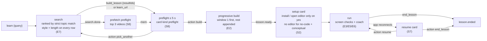

# Pipeline v2: search → pick → preflight → progressive build → setup → run

v1 went straight from the learner's pick to a 45–75 s build and then opened VS Code. That broke in two ways
on Sat 14 Nov:

1. Karpathy's 1 h 56 min "Let's build GPT" failed. Gemini is capped at 45 s, and the transcript fallback got
   429 from YouTube on this network.
2. The goal "build chat gpt" led to a no-code Zapier/Botpress video being picked. It built, and VS Code opened
   with starter files that had nothing to do with it.

v2 adds one cheap, honest step between the pick and the build (**preflight**, ≤ 5 s). The long build only
starts after the learner has seen what the video is and said yes.



## Stages, owners, timing targets

| # | Stage | Owner | Target | Measured (14 Nov) |
|---|---|---|---|---|
| 1 | **Search.** Ranked by strict topic match. Each row carries `kind` (video / repo / blog), `style` (coding / no-code / conceptual), `durationLabel`, `long`, `chapters` (count) and `captions`. | E7 (`server/finder`) | first row ≤ 4 s, done ≤ 13 s | 3.0–3.9 s / 12–13 s (Run 3) |
| 1b | **Prefetch.** On `search.done`, `server.preflight.prefetch(rows, query)` starts preflight for the top 3 videos in the background. | E4 calls it, S8 owns it | free: the later pick returns from the memo | not wired yet |
| 2 | **Preflight.** Metadata + Claude's read + an early tool check, then card `kind: "preflight"`. | S8 (`server/preflight`) | ≤ 5 s hard; a late part re-sends the card within +3 s | cold 3.4–5.0 s; late tool list at 5.3–7.0 s |
| 3 | **Confirm.** The learner presses `build`, or `pick_another` to go back to the results they already have. | Adrian (card UI), E4 | — | — |
| 4 | **Progressive build.** Videos ≤ 30 min are built whole. Longer ones are built window by window: window 1 is chapters from 0:00 grouped to 3–6 min, and the rest are appended in time order, 3 windows in parallel. | E2 (`server/lesson`) | whole ≤ 60 s; window 1 ≤ 45 s | whole 44–69 s (Run 3); E2: Gemini ~40 s on 6 min |
| 5 | **Setup card.** `requirements()` → card `kind: "setup"`. `install` / `open_editor` / `open_in_browser` run only on the learner's yes. No editor for no-code or conceptual lessons. | S2 (`server/workspace`) | ≤ 1 s if preflight warmed it, else ≤ 5 s | cold ~3.7–5.9 s, cached 0.03 s |
| 6 | **Run.** Screen checks, metrics and the coach. | E3 / E5 / E6, wired by E4 | check verdict ≤ 1 s after a save | — |
| 7 | **End / resume.** `end_lesson` is idempotent and cancels in-flight work. On reconnect: "Continue where you left off?" | E4 (end), S7 (resume) | `lesson.ended` ≤ 0.5 s | — |

The UI for the result list, the preflight card, the building progress and the setup card is Adrian's.

## Event sequence (WebSocket, `shared/contracts/events.ts`)

```
App → learn {query}
Eng → status thinking
Eng → search.result × N            (meta: "Video · 1:56:20 · Andrej Karpathy · …", ranked)
Eng → search.done {total}           [engine: prefetch(rows, query) in the background]
App → build_lesson {resultIds:[id]}  (or learn_url {url})
Eng → card {kind:"preflight", title, body, items?, warning?, recommended?, preflight:{…},
            actions:["build","pick_another"(,"install")]}            ≤ 5 s after the pick
Eng → card {kind:"preflight", …}    (only if a late part landed: same card, filled in; it replaces the first)
      ├─ App → action {kind:"pick_another"} → Eng → status idle  (the app shows its result list again)
      ├─ App → action {kind:"install", text: tool}                → setup.progress … (S2's install flow)
      └─ App → action {kind:"build"}
Eng → lesson.building {message, progress} ~1/s
Eng → lesson.ready {lesson, steps}  (long video: window 1's steps, then lesson.ready again with more steps
                                     as each window lands; step ids never change)
Eng → step.started …
Eng → card {kind:"setup", setup:{editorNeeded, items}, actions:[open_editor|open_in_browser, install, skip_setup]}
      └─ App → action open_editor   → VS Code opens (coding lessons only)
… run: check.updated / offtrack / card / spotlight / video.seek …
App → end_lesson {}                  → Eng → lesson.ended {lessonId, reason} + status idle
(app reconnects mid-lesson)          → Eng → card {kind:"resume", actions:["resume","end_lesson"]}
```

## Preflight card

`server.preflight.preflight(url, goal, row=picked_row, on_late=…)` returns everything it learned within 5 s.
`preflight_card(result)` turns that into the card. Nothing in it is invented: a part that misses the deadline is
listed in `missing`, and if it lands later it arrives through `on_late`.

| Field | Source |
|---|---|
| title, channel, duration, description, category, tags | oEmbed + the watch page (plain fetch ~1 s; Bright Data Unlocker as fallback) |
| chapters | YouTube's own chapter list (`chapterRenderer`), else description timestamps (YouTube's rules: from 0:00, ascending, ≥ 3) |
| `style`: coding / no-code / conceptual (E7's vocabulary), `topic`, `goalMatch {score 0–1 \| null, note}`, first hands-on chapter | Claude `claude-haiku-5-5`, structured output, on that metadata plus the finder row's `style` (as a prior; it is also the fallback when Claude is late) and the finder's Gemini skim if it's cached (no new Gemini call) |
| `items` ("Needs: VS Code ✓ Python 3 ✓ torch ✗") | S2's `server.workspace.requirements()` on a metadata-level step graph (lesson id `preflight-<videoId>`) |
| `buildPlan {strategy whole\|chapters, firstChapter, firstHandsOn, estSecondsToFirstSteps}` | E2's `plan_windows` (local mirror when it isn't importable) |
| `warning`, `recommended: "pick_another"` | when `goalMatch.score < 0.5` |

Live cards (14 Nov, cold, this network):

| Video | Goal | Card | Latency |
|---|---|---|---|
| kCc8FmEb1nY Karpathy "Let's build GPT" | build an LLM | Coding · 1:56:20 · 30 chapters · match 0.9 · "Long video: I'll build 0:00–7:52 first (~42 s)… Hands-on starts at 7:52". Late update: "Needs: Visual Studio Code ✓ Python 3 ✓ torch ✗" + `install` | 4.97 s, late 6.33 s |
| zE2MJ3_muNQ "How to Build AI Agent with ChatGPT" (AI Master) | build chat gpt | No-code · 19:29 · 10 chapters · match 0.2 · ⚠ "This video builds no-code support bots, not an LLM." · No code editor needed · "Needs: ChatGPT (web) … Botpress (web) Zapier (web)" | 4.74 s |
| MXId-Ae6k_I "How to Build a Todo-List-App with React" | build a todo app in React | Coding · 15:04 · 7 chapters · match ~0.95 · "Building takes ~53 s." · "Needs: Visual Studio Code ✓ Node.js ✓" | 4.95 s |

## Contract (additive, one PR)

All lifecycle contract changes go in the one combined `contract:` PR (#17, branch `contract/end-lesson`):
`end_lesson` + `lesson.ended` (E4), the resume card (S7), the setup card + `setup.progress` (S2), and the
preflight additions. The preflight additions are on branch `contract/preflight-additions` (2 commits on top of
`contract/end-lesson`), ready to cherry-pick:

- card `kind: "preflight"` (`preflight.style` uses the finder's coding / no-code / conceptual), plus optional fields `items?: SetupItem[]`, `warning?`, `recommended?`, `preflight?: PreflightInfo`
- action kinds `build` and `pick_another` (also on the card's `actions`)
- `SetupItem.kind` `"web_app"`, `install.method` `"open"`, action `open_in_browser` (S2's no-code items, PR #22)

## Open items

- **E4:** wire preflight between the pick and `_build`, and call `prefetch` on `search.done` (the exact hook is in
  `server/preflight/README.md`).
- **E2:** progressive `on_update` → re-emit `lesson.ready` with the appended steps. Could be a `lesson.updated`
  event instead; that would be a contract change, so it would go in the same PR. Optionally accept preflight's
  metadata (chapters, duration, description) to skip the second watch-page fetch, and start window 1 at
  `buildPlan.firstHandsOn` when the intro is long.
- **S2:** the real lesson's `requirements()` is cold again because its cache key is the lesson id, not
  `preflight-<videoId>`. Either reuse the preflight items when the build is done, or key on the video URL.
- **E7:** prefetching 3 preflights costs 3 haiku calls per search (~1–2 k tokens each); keep `top=3`.
